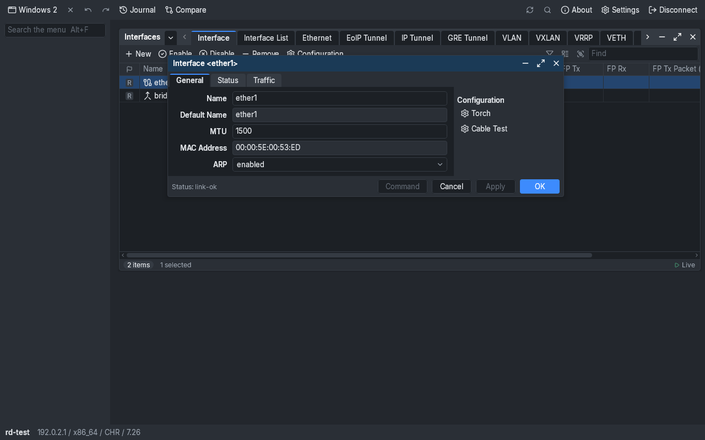
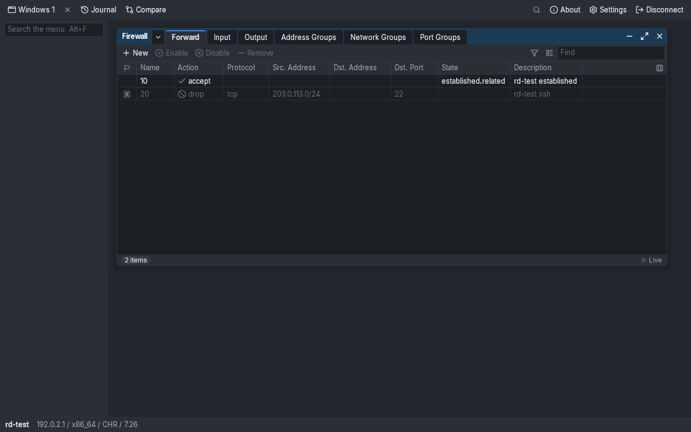
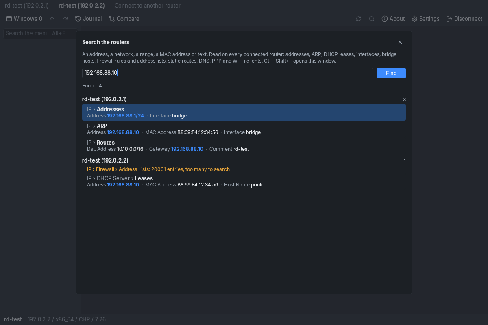
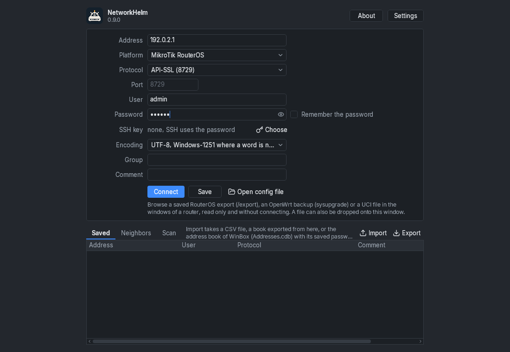
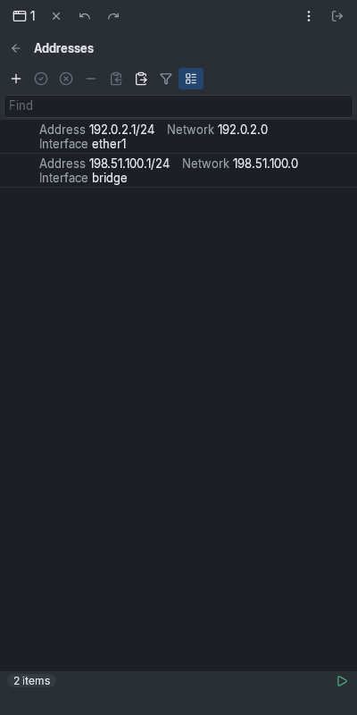

# NetworkHelm

A program for managing routers. It follows WinBox from MikroTik: a menu tree on the left, tabbed windows in the workspace, tables that update while you look at them. The difference is that it runs on macOS, Linux, Android and in a browser as well as on Windows, and it handles more than MikroTik. The project is independent; MikroTik and the other router makers have nothing to do with it.

**Русский:** [README.ru.md](README.ru.md)

## Which routers it works with

| Router | What you can do | Checked on |
| --- | --- | --- |
| MikroTik RouterOS 7 | view and change | virtual routers (CHR): a recent one, 7.25 and 7.17.2 |
| MikroTik RouterOS 6 | view and change | CHR 6.49.23 and 6.42.12 |
| OpenWrt | view and change | 25.12 and 24.10 in virtual machines, a Wi-Fi router on 25.12 |
| OPNsense | view and change | 24.7 and 26.7 in virtual machines |
| pfSense | view and change | CE 2.7.2 in a virtual machine |
| VyOS 1.4 and later | view and change | rolling 2026.10.23 in a virtual machine |
| Teltonika RutOS | like OpenWrt, plus an LTE window | not checked |
| Keenetic, Netcraze | view only | not checked |
| Linux over SSH | view only | the OpenWrt virtual machines |
| SNMP, UPnP, TR-064 | view only | SNMP and UPnP on the Wi-Fi router, TR-064 not checked |

"Not checked" means the driver passed its tests against answers built from the vendor's description, and the author never had the real device. If you have one, a report on how it went is welcome: [SUPPORT.md](SUPPORT.md).

For MikroTik the program connects over the WinBox port 8291 (it is picked first whenever the port answers), the API (encrypted or not), REST and SSH, and to a router that has no IP address yet over its MAC address. Which of these to switch on at the router itself is described in the [guide](GUIDE.md).

## What it does

- Shows the menus and windows of a router the way WinBox users know them: a menu tree with search (Alt+F), windows with tabs, dialogs with Apply and OK. The tabs, the order and labels of fields and the columns of tables come from the router itself, so the sections of a new RouterOS version appear without an update of the program.
- Updates tables live. Rows can be filtered, sorted and shown in the columns you choose, and the selected ones copied as ready `add` commands, as text, CSV or JSON.
- Shows the command an edit will run before you press Apply, marks a value the router would refuse, and keeps a journal of the edits of the session.
- Turns on Safe Mode wherever the router has a way to take an edit back when the connection is lost. Where it has none, the program says so.
- Tells in the toolbar when the router reports a newer RouterOS and when GitHub has a newer release of the program (the desktop and Android apps look once, at start). Without an answer nothing is shown. The window "Check For Updates" changes the channel at once and shows the list of changes of the offered version: over port 8291 the text comes from the router, otherwise the desktop and Android apps ask MikroTik's server while the window is open (the [privacy policy](privacy-policy.md) says what goes out).
- Opens a terminal over SSH with ready-made commands and the files of a router over SFTP, with a viewer and an editor (highlighting, search and replace, saving back to the router). It also does SSH tunnels, connections through another router and keys from ssh-agent.
- Shows the log of a router coloured by severity, and searches all connected routers at once by address, network, MAC address or text.
- Opens a saved configuration without a router (`/export` of RouterOS, an OpenWrt backup, VyOS commands) in the same windows and compares it with another one.
- Keeps an address book with groups, imports a CSV file or the address book of WinBox, and exports it sealed with a master password. It finds MikroTik routers on the local network by itself (the Neighbors tab) and can scan a subnet.
- For RouterOS there are Ping, Torch, Traceroute, Packet Sniffer and traffic graphs.

## Download

The files are on the [releases](https://github.com/vasmarfas/networkhelm/releases) page. The description of each release opens with a table: processors in the rows, systems in the columns.

- Windows: the installer (`windows-setup.exe`), the portable EXE (`windows-portable.exe`) or an MSI.
- macOS: a DMG for Apple silicon (`macos-arm64`) or for Intel (`macos-x64`).
- Linux: a DEB or RPM package, or an AppImage.
- Android: the APK.
- iOS: only an Xcode project in `app/iosApp` for now. There is no ready app in the App Store.
- Browser: a page with made-up routers opens without any install, https://vasmarfas.github.io/networkhelm/. Your own routers are opened in a browser through a gateway, see below.

The portable EXE needs no install. On its first start it unpacks itself once into `%LOCALAPPDATA%\NetworkHelm\portable\<version>` (about 200 MB), starts from there afterwards and keeps its settings in the `NetworkHelm data` folder beside the file. The AppImage mounts itself through FUSE and needs `fusermount` from the `fuse3` or `fuse` package; without FUSE, start it with `--appimage-extract-and-run`.

Files marked `legacy` are built for 64-bit Windows 7 SP1 and 8 (on Java 17), files marked `arm64` for Windows and Linux on ARM processors. The author has not been able to run them on such hardware yet. If the build of one of them failed, the release does not have that file. If you try one, tell us how it went.

### What you need to run it

Windows 10 or newer, 64-bit (on older Windows the installer and the portable EXE stop with a message about the version of Windows), macOS 12 or newer, Linux on x86_64 or arm64 with glibc 2.28 or newer (Debian 10, Ubuntu 20.04, RHEL 8), Android 7.0 or newer, iOS 15 or newer. Windows XP and Vista are not supported.

In a browser the app runs as WebAssembly where the browser has WebAssembly GC: Chrome and Edge 119, Firefox 120, Safari 18.2 (on an iPhone or iPad that is iOS 18.2). Older browsers get a JavaScript build instead. It is slower and needs a browser of about 2021 or newer (Chrome 85, Firefox 79, Safari 14.1).

## First connection

1. Start the program. The connection window opens.
2. Type the address of the router: a name or an IP address, with a port only if it is not the standard one. Almost at once the program checks which ports answer, recognises the device and picks a protocol. Ports that gave no answer are grey in the list of protocols.
3. Enter the login and password of the router. The "Remember the password" box keeps the password in the protected storage of the system.
4. Press "Connect".

If the connection goes over a protocol without encryption (the API on port 8728, HTTP, SNMP v2c), a warning appears under the fields and the main window carries a "Not encrypted" mark. On a MikroTik you can click that mark: it opens the "Prepare router" window, which turns on the encrypted API-SSL. Something went wrong? The [guide](GUIDE.md) has a section called "When something does not work".

 

## In a browser

A browser cannot open connections to routers on its own, so a small program called the gateway stands between the two. The simplest way to get one is the desktop app: "Settings", "Access from a browser…", set a password and press "Open the access". After that NetworkHelm opens in the browser of a phone, a tablet or another computer on the network, at the address the same window shows. The browser works with the list of routers and the passwords of that computer.

The gateway can also run on its own: as an archive with its own Java for Windows and Linux, as a jar (Java 17 or newer is needed) or as a Docker container. An OpenWrt router can serve the page itself, without a gateway, but a page served that way has no terminal and no files. Details are in the [guide](GUIDE.md); the gateway with all its options is described in [server/README.md](server/README.md), the page without a gateway in [app/webApp/README.md](app/webApp/README.md).

## How it works

The program talks to routers through the interfaces they publish themselves. Fields and their choices come from the router where it can describe them: `/console/inspect` on RouterOS 7, the OpenAPI of pfSense, the forms of LuCI on OpenWrt. The layout of RouterOS 7 windows (tabs, the order and labels of fields, the columns of lists) is read from the interface descriptions the router serves to its own clients; where it serves none, the interface packs in the `packs` folder are used. What the console and the API do not print and WinBox shows (the Resources tab, the dashboard of a controller, the columns of read-only tables) is read from the object model of port 8291, read only, where the router has WinBox turned on.

The client for port 8291 is written from public descriptions of the protocol. No code, file or recorded traffic of WinBox is used.

## Building from source

Gradle provisions the JDK through the toolchain resolver: JDK 21 for the build and the JetBrains Runtime for the desktop app. The Android app needs the Android SDK, the iOS app a Mac with Xcode.

| Target | Command |
| --- | --- |
| Desktop | `./gradlew :app:desktopApp:run`, with Compose Hot Reload `./gradlew :app:desktopApp:hotRun --auto` |
| Android | `./gradlew :app:androidApp:assembleDebug` |
| Browser (Wasm) | `./gradlew :server:run`, then `https://localhost:8443`: the gateway serves the web app and reaches the routers for it |
| Browser without a gateway | `./gradlew :app:webApp:pagesBundle`: the page for a static host such as GitHub Pages, with demo routers and the devices the browser lets it reach |
| iOS | `tools/ios/build-ssh.sh` once, then open `app/iosApp` in Xcode |

One Kotlin Multiplatform and Compose Multiplatform codebase builds for all of these systems.

## Privacy, terms, support

The app sends nothing to the developer: there is no account, and no analytics or crash reports either. What it stores and where is described in [privacy-policy.md](privacy-policy.md), the terms of use are in [terms.md](terms.md), and how to support the project is in [SUPPORT.md](SUPPORT.md).

## License

The source is available for viewing (source-available) under [PolyForm Noncommercial License 1.0.0](LICENSE) with the additions in [NOTICE.md](NOTICE.md). Personal and other noncommercial use is free, commercial use needs a separate agreement. A fork may not be renamed or distributed as a separate product. Pull requests are welcome, and forking to prepare one is the normal way to contribute; the contribution terms and the clean-room rule every contribution follows are in [NOTICE.md](NOTICE.md). Third-party components are listed in [THIRD-PARTY-NOTICES.md](THIRD-PARTY-NOTICES.md).

## Trademarks

MikroTik, RouterOS, WinBox and RouterBOARD are trademarks of SIA Mikrotīkls. OpenWrt is a registered trademark of Software Freedom Conservancy. OPNsense, pfSense, VyOS, Keenetic, Netcraze, Teltonika and FRITZ!Box belong to their owners. NetworkHelm is an independent project, not affiliated with, endorsed by or sponsored by any of them.
